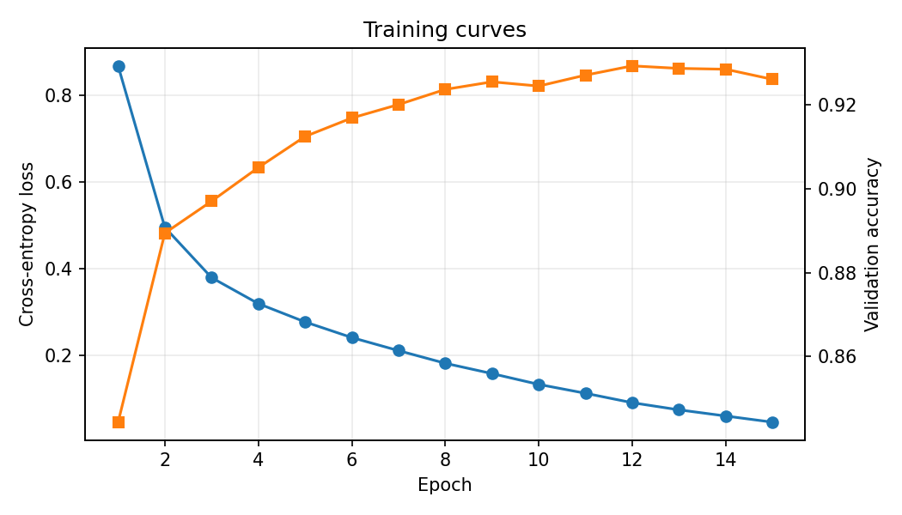
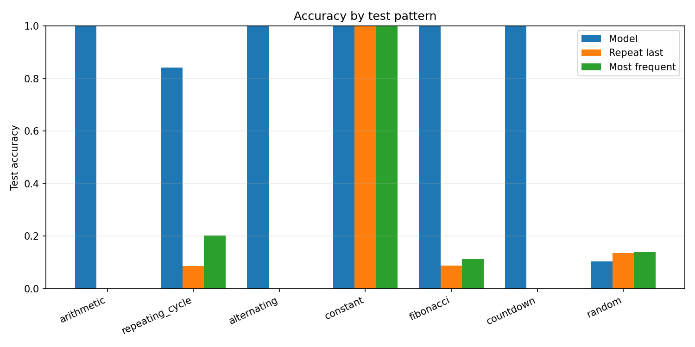

# 1. Next-Digit Prediction with a GRU

**Name:** Palak Singh  
**USN:** 24BTRCL147

## 2. Objective

Build and evaluate a compact PyTorch model that learns patterns in digit sequences and predicts the next digit. Compare its performance with two simple prediction rules.

## 3. Problem Statement

Given ten observed digits from 0 to 9, predict the eleventh digit. Arithmetic, Fibonacci-like, and countdown rules wrap modulo 10.

## 4. Dataset

The dataset is generated synthetically with NumPy. Each example has a pattern tag. The six structured families are arithmetic progressions with a nonzero step, repeating cycles of length 2–5, alternating distinct digits, constant digits, Fibonacci-like sequences, and countdowns. Each example has a 5% chance of being an independent random sequence; otherwise its family is sampled uniformly from the six structured types.

| Split | Examples | Seed |
|---|---:|---:|
| Training | 50,000 | 42 |
| Validation | 5,000 | 43 |
| Test | 5,000 | 44 |

Separate seeds make the splits reproducible. Training also seeds Python, NumPy, and PyTorch with 42.

## 5. Model Architecture

The classifier processes each digit token through an embedding and a two-layer recurrent network. Its final recurrent hidden state is mapped to ten class scores:

**Embedding(10, 32) → 2-layer GRU(input size 32, hidden size 128) → Linear(128, 10)**

The model uses batch-first GRU inputs. The linear layer’s ten logits correspond to the possible next digits, 0–9.

## 6. Training Setup

Training uses **cross-entropy loss**, **Adam** with learning rate **0.001**, and batch size **128**. It runs for at most **15 epochs**. Early stopping checks validation accuracy and triggers after **four consecutive epochs** without improvement. The best checkpoint is saved as `model.pt`; this run reached epoch 15, with its best checkpoint at epoch 12 (CPU runtime: **115.4 seconds**).

## 7. Results

The epoch-12 checkpoint reached **92.92% validation accuracy** and **93.40% overall test accuracy**. The baselines repeat the last digit or predict the most frequent input digit (ties go to the most recent tied digit). The figures and table below are from the same fixed-seed run.

| Test category | Examples | GRU model | Repeat last | Most frequent |
|---|---:|---:|---:|---:|
| Overall | 5,000 | **93.40%** | 18.16% | 20.42% |
| Arithmetic | 803 | 100.00% | 0.00% | 0.00% |
| Repeating cycle | 791 | 84.20% | 8.60% | 20.23% |
| Alternating | 811 | 100.00% | 0.00% | 0.00% |
| Constant | 737 | 100.00% | 100.00% | 100.00% |
| Fibonacci-like | 810 | 100.00% | 8.89% | 11.36% |
| Countdown | 819 | 100.00% | 0.00% | 0.00% |
| Random | 229 | 10.48% | 13.54% | 13.97% |

Figure 1 shows training loss and validation accuracy through epoch 15.

{ width=75% }

Figure 2 compares test accuracy by pattern with both baselines.

{ width=85% }

## 8. Discussion

The GRU learned the structured continuations: it reached 100% on arithmetic, alternating, Fibonacci-like, countdown, and constant test examples. At 84.20%, repeating cycles were harder to infer from ten digits. Both baselines also solved constant sequences, but usually failed to extend changing patterns. The model's 10.48% on random examples is near the 10% chance level and below both baselines on that subset.

These scores apply to this synthetic distribution and fixed split. Different rules can produce the same ten-digit prefix, while real sequences may follow other rules or contain noise. The random subset has only 229 test examples, making its estimate less stable than the overall result. The experiment does not test calibrated confidence or generalization to arbitrary sequence rules.

## 9. Conclusion

The two-layer GRU achieved **93.40% test accuracy**, versus **18.16%** and **20.42%** for the baselines. It learned most structured rules well, while repeating cycles remained less reliable and random next digits were unpredictable.

## 10. How to Run

Install the requirements and train from the project directory:

```bash
python -m pip install -r requirements.txt
python train.py
```

Training saves the selected checkpoint and regenerates both plots. To predict from a sequence of at least three digits, run:

```bash
python predict.py 1 3 5 7 9
```

